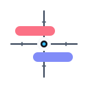
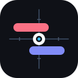

# rekon Brand Assets & Guidelines

Brand guidelines and visual assets for `rekon` and the `rekon-rs` organization.

## Philosophy & Symbolism

The `rekon` mark embodies the two independent axes of engineering effort in the age of AI agents:

```
        Human Attention (Serial Bottleneck)
            [===========] (Rose)
                  |
     ----+--------o--------+----  <- Time Axis (Timeline across 24h)
                  |
             [===========] (Violet)
          Machine Compute (Parallel Scale)
```

1. **Upper Ledger Bar (Rose `#f43f5e`)**: **Human Attention Axis**.
   - Measures human cognitive focus: code reviews, meetings, design synthesis, architectural steering, and prompt generation.
   - Serial bottleneck: an engineer can only attend to one item at a time.
2. **Lower Ledger Bar (Violet `#8b5cf6`)**: **Machine Compute Axis**.
   - Measures autonomous agent activity: tool calls, token usage, background verification, test executions, and direct dollar costs ($).
   - Parallel scale: multiple agents run simultaneously across multiple repositories.
3. **The Offset**:
   - The two bars do not merge or sum together. Rekon's thesis is that human attention and machine compute are distinct dimensions that cannot be collapsed into a single scalar value.
4. **The Coordinate Cross (Reticle & T-Account)**:
   - **Horizontal line**: The time dimension across the daily reconstruction window.
   - **Vertical line**: The ledger divider separating inputs and outputs, attention and compute (analogous to the classic accounting T-account divider).
   - Caliper tick marks evoke scientific precision instrumentation.
5. **The Center Fulcrum**:
   - The reckoning point where human steering and autonomous machine execution meet to reconcile an approved work item.

---

## Assets

| Asset | File | Description | Target Use |
| :--- | :--- | :--- | :--- |
| **Primary Logo** | [`brand/logo.svg`](./logo.svg) | High-detail vector mark with coordinate reticle and caliper ticks on a transparent background. | Headers, documentation, README heroes, presentations (>= 28px). |
| **Symbol / App Icon** | [`brand/symbol.svg`](./symbol.svg) | Primary mark housed inside an obsidian squircle container (`#0f1117`). | Organization avatar, app icon, social previews. |
| **Optical Favicon** | [`brand/favicon.svg`](./favicon.svg) | Tuned for 16px - 32px pixel grids. Edge-to-edge transparent with responsive light/dark browser tab support. | Browser favicons, bookmarks, status bar icons. |

### Raw Embedding URLs

```markdown
<!-- Primary Mark -->


<!-- Obsidian Symbol -->


<!-- Favicon -->
<link rel="icon" type="image/svg+xml" href="https://raw.githubusercontent.com/rekon-rs/.github/main/brand/favicon.svg" />
```

---

## Color Palette

| Token | Hex | Role | Semantic Meaning |
| :--- | :--- | :--- | :--- |
| **Attention** | `#f43f5e` | Primary warm | Human cognitive focus, serial bottleneck, meetings, reviews |
| **Compute** | `#8b5cf6` | Primary cool | Machine compute, parallel agent sessions, token telemetry, dollar costs |
| **Fulcrum Core** | `#38bdf8` | Accent luminous | Reckoning balance point, active attribution, telemetry pulse |
| **Obsidian Canvas** | `#0f1117` | Neutral background | Deep slate canvas for developer tooling |
| **Reticle** | `#475569` | Structural axis | Coordinate geometry, timeline axis, caliper ticks |
